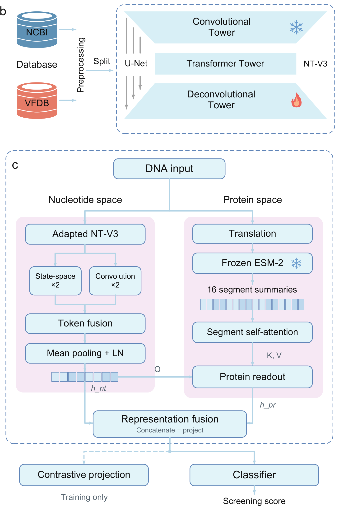

# DuetScreen

Reference implementation of **DuetScreen**, a dual-space screening model for DNA
sequences. The model pairs a partially adapted Nucleotide Transformer v3 encoder
(decoder trainable; convolutional tower and transformer backbone frozen) with a
frozen protein language model: the translated open reading frame is encoded as a
16-segment positional profile by ESM2-35M, refined by a segment self-attention
block, and read out through a nucleotide-conditioned cross-attention. A
dual-stream downstream network (Mamba blocks plus a ConvNeXt-style side branch)
processes the nucleotide representation, and the two spaces are combined by late
fusion. The classification head is trained with the multi-view supervised
objective described in the paper.

The model is intended for **biosecurity screening research**: flagging material
derived from sequences of concern. It does not predict whether a sequence is
expressed, viable or functional.

## Table of contents

- [Architecture](#architecture)
- [What is included](#what-is-included)
- [Project layout after setup](#project-layout-after-setup)
- [Data availability](#data-availability)
- [Model weights](#model-weights)
- [Environment](#environment)
- [Quickstart](#quickstart)
- [Toy validation (1 epoch)](#toy-validation-1-epoch)
- [Training from the public dataset](#full-retraining-from-the-public-dataset)
- [Prediction](#predict)
- [Training](#train)
- [Output files](#output-files)
- [Configuration reference](#configuration-reference)
- [FAQ](#faq)
- [Citation and license](#citation-and-license)

## Architecture



**b**, The NT-V3 encoder: the convolutional tower and transformer backbone are frozen, the
deconvolutional tower is adapted for the screening task. **c**, Dual-space model: the nucleotide
stream (adapted NT-V3, state-space and convolution branches, token fusion) and the protein stream
(translation, frozen ESM2-35M, 16 segment summaries, segment self-attention, protein readout) are
fused into a joint representation, followed by the classification head and the training-only
contrastive projection.

## What is included

- `duetscreen/`: model, encoder, data pipeline, training-view generator, protein cache, trainer and prediction CLI.
- `configs/duetscreen_release.json`: the configuration used for the reported runs.
- `docker/`: container entry points for training, smoke training and prediction.
- `tools/`: cache-coverage and result-verification utilities.
- `toy/`: one-epoch toy workflow; `toy/data/` and `toy/cache/` are created after unpacking the toy archive.
- `Dockerfile`, `requirements.txt`: pinned environment.
- `docs/`: setup and troubleshooting notes.

## What is not tracked in git

- Benchmark sequences (Zenodo, DOI below).
- Encoder weights (Hugging Face).
- Run outputs: `runs/`, checkpoints, protein caches and logs are created locally.

## Project layout after setup

A working checkout after downloading the encoder, the dataset and running one training job:

```
DuetScreen/
├── duetscreen/                  model, encoder, data, trainer, predict CLI
├── configs/                     released configuration snapshot
├── docker/                      run_train.sh, run_predict.sh, run_train_smoke.sh
├── docs/                        setup notes
├── tools/                       cache coverage and result verification
├── Dockerfile
├── requirements.txt
├── run_full_training.sh
├── run_quickstart.sh
├── toy/
│   ├── README.md
│   ├── run_toy.sh
│   ├── run_toy.ps1
│   ├── expected_metrics.json
│   ├── data/                    after unpacking DuetScreen_ToySubset.zip
│   │   ├── train_toy.fasta
│   │   ├── val_toy.fasta
│   │   └── test_toy.fasta
│   └── cache/                   after unpacking DuetScreen_ToySubset.zip
│       ├── variants_data_toy.pkl
│       └── protein_seg_cache_toy.pkl
├── assets/
│   └── NTv3_8M_pre/             nucleotide encoder (Hugging Face download)
├── data/
│   └── mixed/
│       ├── train.fasta
│       ├── val.fasta
│       └── test.fasta
└── runs/
    └── full_seed42/
        ├── variants_data.pkl    training views built from train/val
        ├── protein_seg_cache.pkl
        └── seed42/
            ├── best_nucleotide_v3_mamba_model.pth
            ├── nucleotide_v3_training_log.json
            ├── progress.jsonl
            └── complete.json
```

The Docker image `duetscreen-release:1.0` is built once from the repository root; no other local
state is required. `runs/` is created by the training script and is not tracked by git.

`toy/data/` and `toy/cache/` are not tracked in git: unpack
`DuetScreen_ToySubset.zip` (https://doi.org/10.5281/zenodo.23538086) directly into `toy/`. The
archive already contains the `data/` and `cache/` folders, and `toy/run_toy.sh` writes its outputs to
`toy/out/`.

## Data availability

The benchmark dataset is archived on Zenodo: **https://doi.org/10.5281/zenodo.23534656**
(mixed pool, strict pool and the species/family holdout sets, `pos_`/`neg_` labels in the FASTA IDs).

| Archive | Files to place under `data/` | Records |
|---|---|---|
| `mixed pool.zip` | `mixed/train.fasta`, `mixed/val.fasta`, `mixed/test.fasta` | 13,430 / 1,679 / 1,679 |
| `strict pool.zip` | `strict/train.fasta`, `strict/val.fasta`, `strict/test.fasta` | 6,446 / 805 / 805 |
| `holdout pool.zip` | `holdout/generalization_species.fasta`, `holdout/generalization_family.fasta` | 1,164 / 817 |

```bash
mkdir -p data && cd data
wget "https://zenodo.org/records/23534656/files/mixed%20pool.zip?download=1" -O mixed_pool.zip
wget "https://zenodo.org/records/23534656/files/strict%20pool.zip?download=1" -O strict_pool.zip
wget "https://zenodo.org/records/23534656/files/holdout%20pool.zip?download=1" -O holdout_pool.zip
unzip -o mixed_pool.zip -d mixed && unzip -o strict_pool.zip -d strict && unzip -o holdout_pool.zip -d holdout
cd ..
```

The training recipe writes the checkpoint to
`runs/full_seed<ID>/seed<ID>/best_nucleotide_v3_mamba_model.pth`; prediction accepts that path
through `MODEL=` or `--model`. Training is stochastic, so a fresh run follows the
same recipe and performance range as the paper's seeds without being bit-identical (the seed-42
reference reached 0.8497 validation combined accuracy).

Encoder weights are obtained from their upstream releases (see below).

## Model weights

The seed-42 checkpoint and the NT-V3 encoder are archived at
**https://doi.org/10.5281/zenodo.23535423** (CC BY 4.0):

| File | Contents |
|---|---|
| `best_nucleotide_v3_mamba_model.pth` | seed-42 checkpoint (90 MB) |
| `NTv3_8M_pre.zip` | NT-V3-Pre-8M encoder folder (29 MB) |

Unpack `NTv3_8M_pre.zip` to `assets/NTv3_8M_pre` and pass the checkpoint to prediction with
`--model`. Training writes its own checkpoint to `runs/full_seed<ID>/seed<ID>/`; the released
seed-42 checkpoint can be used for prediction or as a starting point.

## Environment

Two paths use the same code. The Docker path pins the CUDA/torch/Mamba combination and is the
recommended route; the native path is for users who already have a matching toolchain.

### Option A: Docker (recommended)

```bash
docker build -t duetscreen-release:1.0 .
```

The image is based on `pytorch/pytorch:2.8.0-cuda12.8-cudnn9-runtime` and builds the Mamba kernels
during the image build (about 20 minutes once). Only `Dockerfile` and `requirements.txt` are shipped;
the image itself is built locally, and no prebuilt image or weight archive is distributed.

### Option B: native Python

```bash
python -m venv .venv && . .venv/bin/activate
pip install "torch==2.8.0" --index-url https://download.pytorch.org/whl/cu128
pip install -r requirements.txt
pip install causal-conv1d==1.5.3.post1 mamba-ssm==2.2.6.post3
```

`mamba-ssm` and `causal-conv1d` compile against the CUDA toolkit; a matching `nvcc` is required if no
prebuilt wheel fits your platform.

### Tested versions

| Component | Version |
|---|---|
| Python | 3.11 |
| PyTorch | 2.8.0 (CUDA 12.8) |
| CUDA runtime / driver | 12.8 / >= 570 |
| mamba-ssm | 2.2.6.post3 |
| causal-conv1d | 1.5.3.post1 |
| transformers | 4.57.1 |
| GPU memory | >= 8 GB for training |

## Quickstart

A four-step environment check: Docker, the NT-V3 encoder folder, the image build and the package
import. It does not download data or weights and does not run a prediction.

```bash
./run_quickstart.sh                          # Linux / macOS / Git Bash
ASSETS=/path/to/assets ./run_quickstart.sh   # folder containing NTv3_8M_pre/
```

A Windows wrapper is included with the same options.

The script builds `duetscreen-release:1.0` from the included `Dockerfile` when the image is absent,
then checks that `torch` and `duetscreen` import inside the container. A ready environment ends with
`READY`.

**Prerequisites**: Docker with GPU support (`--gpus all` requires an NVIDIA driver and the NVIDIA
Container Toolkit), ~20 GB free disk, internet access for the first build and for the ESM2 download.

```
release/
  DuetScreen/          <- this package (docker build here)
  assets/
    NTv3_8M_pre/       <- Hugging Face download
```

```bash
cd DuetScreen
docker build -t duetscreen-release:1.0 .   # about 20 minutes; compiles the Mamba kernels once
```

Training and prediction commands are documented below; the wrappers in `docker/` run the same steps
inside the container. Only `Dockerfile` and `requirements.txt` are shipped; the image is built
locally.

**Scoring sequences outside the released record set**: the protein channel reads
a cache keyed by exact DNA sequence. Build a cache for your own records first
(GPU recommended; ~1–2 min for thousands of short records after the first model
download):

```bash
docker run --rm --gpus all --entrypoint python \
  -v "$PWD/assets:/assets:ro" -v "$PWD/work:/work" \
  duetscreen-release:1.0 -m duetscreen.protein_cache \
  --input /work/your_records.fasta --output /work/protein_seg_cache_custom.pkl \
  --esm2 facebook/esm2_t12_35M_UR50D --device cuda --batch-size 16
# then point DUETSCREEN_PROTEIN_SEG_CACHE at /work/protein_seg_cache_custom.pkl
```

Records without a stop-free ORF of at least 30 nt have no row; the model then
falls back to a zero protein vector, which is the trained "no protein channel"
condition. Rebuilding a cache with this module reproduces rows to fp16 precision
(max |diff| 5e-4).

## Toy validation (1 epoch)

A fixed 120/40/40 subset with precomputed training views and protein cache is distributed
separately (`DuetScreen_ToySubset.zip`, https://doi.org/10.5281/zenodo.23538086). Unpack it into `toy/` so
that `toy/data/` and `toy/cache/` exist, then run:

```bash
ASSETS=assets ./toy/run_toy.sh
```

The script trains for one epoch on the toy split and predicts the toy test set. On one GPU this
takes about two minutes and exercises data loading, view construction, the protein cache, training,
checkpoint writing and prediction end to end. Sanity values for seed 42 are validation accuracy
0.8125 and validation AUROC 0.5876. This is a pipeline check, not a performance benchmark: the
one-epoch test predictions are expected to be close to all-positive or all-negative.

## Full retraining from the public dataset

The package contains the complete training path: split preparation, the
supervised view generator (synonymous/codon-conservative and fragment-confusion
views plus random-mutation contrastive negatives), the protein-cache builder,
the trainer, and the audit checks. No paper checkpoint is required.

| Stage | Command | Output |
|---|---|---|
| training views | `python -m duetscreen.build_cache --train-fasta ... --val-fasta ...` | `variants_data.pkl` |
| protein cache | `python -m duetscreen.protein_cache --input ... --output ... --esm2 ...` | `protein_seg_cache.pkl` |
| training | `python -m duetscreen.train --records ... --ntv3-model ...` | `best_nucleotide_v3_mamba_model.pth` |

`run_full_training.sh` runs the three stages in order and skips a stage whose output already exists.

```bash
# 1) dataset (mixed pool shown; strict pool and holdouts are separate archives)
wget -O mixed_pool.zip "https://zenodo.org/records/23534656/files/mixed%20pool.zip?download=1"
unzip -o mixed_pool.zip -d data/mixed          # train.fasta, val.fasta, test.fasta

# 2) nucleotide encoder (Hugging Face)
huggingface-cli download InstaDeepAI/NTv3_8M_pre --local-dir assets/NTv3_8M_pre

# 3) build the Docker image once
docker build -t duetscreen-release:1.0 .

# 4) train (builds the record cache and, if absent, the ESM2 protein cache automatically)
DATA=data/mixed ./run_full_training.sh
SEED=43 EPOCHS=20 DATA=data/mixed ./run_full_training.sh
```

The protein cache is rebuilt on the fly with `facebook/esm2_t12_35M_UR50D` when no cache is present,
so the only assets needed are the dataset and the NT-V3 encoder folder. `ASSETS=` can
point at any directory containing `NTv3_8M_pre/`.

The script (1) builds `variants_data.pkl` with the same generator and the same
configuration fields as the released runs, (2) builds and checks the protein
cache (ESM2-35M when absent), and (3) trains
20 epochs with early stopping and keeps the best checkpoint by validation
combined accuracy. Expect several hours on one GPU for the full split
(~15k records); the paper's seed-42 run reached 0.8497 validation combined
accuracy, which is the reference range for a healthy run.

The result is **the same method, trained on your machine**: same architecture,
objective, data and hyper-parameters, but a fresh initialization, so it will not
be bit-identical to the paper's checkpoints (training is stochastic; the ten
paper seeds differ from each other in the same way).

Minimum requirements: a cache with at least 8 training records per class for the
one-step `--smoke` check; the full recipe expects the complete split.

## Required assets

| asset | role | source |
|---|---|---|
| NT-V3-Pre-8M | nucleotide encoder with trainable decoder and frozen backbone | `InstaDeepAI/NTv3_8M_pre` on Hugging Face, local folder |
| ESM2-35M (`esm2_t12_35M_UR50D`) | frozen protein encoder | `facebook/esm2_t12_35M_UR50D` on Hugging Face |
| trained checkpoint | needed for prediction; produced by the training recipe | your own run |

`assets_manifest.json` records the expected file names and SHA-256 values for the
encoder folder and, when present, the protein cache and checkpoints of a local run.

## Build the protein cache

The protein channel reads a cache of 16-segment ESM2-35M embeddings keyed by DNA
sequence. `run_full_training.sh` builds it when absent; rebuild it explicitly only
for new record sets (GPU recommended):

```bash
python -m duetscreen.protein_cache \
    --input  records.fasta \
    --output protein_seg_cache_35m.pkl \
    --esm2   /assets/esm2_t12_35M_UR50D   # or facebook/esm2_t12_35M_UR50D
export DUETSCREEN_PROTEIN_SEG_CACHE=$PWD/protein_seg_cache_35m.pkl
```

Records without a stop-free interval of at least 30 nt receive a zero vector;
the projection learns a "no protein channel" bias from that case.

## Predict

```bash
python - <<'PY'
from duetscreen.predict import SimpleNTv3Predictor
p = SimpleNTv3Predictor('best_nucleotide_v3_mamba_model.pth', output_dir='out', threshold=0.5)
p.predict('records.fasta', batch_size=64, threshold=0.5)
PY
```

Outputs per-record scores plus a metrics block when labels are present in the
FASTA headers (`|label:1` / `|label:0`).

| Argument | Required | Meaning |
|---|---|---|
| `--fasta` | yes | input FASTA |
| `--model` | yes | checkpoint path |
| `--threshold` | no | classification threshold (default 0.5) |
| `--batch-size` | no | inference batch size (default 64) |
| `--output-dir` | no | output directory |

## Train

Training expects a pickle holding the prepared record list. Each record is a
dict with at least:

```
original_seq           str, DNA sequence
original_label         int (0/1)          # 'label' is accepted as a fallback
segment_id             str (optional)
positive_views         list[str] (optional)  # supervised alternative views
view_types             list[str]          # 'semantic' / 'confusion', same order
random_mutation_sequence  str (optional)  # random-mutation view
split                  'train' | 'val' | 'test'
```

```bash
python -m duetscreen.train \
    --records records.pkl --output-dir runs/seed42 \
    --ntv3-model /path/to/NTv3_8M_pre --seed 42 \
    --epochs 20 --patience 5 --batch-size 16 --max-seq-len 2048
python -m duetscreen.train ... --smoke     # one forward/backward check
```

The trainer writes `model_audit.json` (parameter budget: downstream ≤ 4M),
`optimizer_audit.json`, `progress.jsonl`, `best_nucleotide_v3_mamba_model.pth`
(selected by validation combined accuracy, first maximum, 1-based epoch) and
`complete.json`.

## Output files

| Stage | File | Description |
|---|---|---|
| training | `variants_data.pkl` | supervised views built from train/val |
| training | `protein_seg_cache.pkl` | 16-segment ESM2-35M cache |
| training | `best_nucleotide_v3_mamba_model.pth` | checkpoint selected by validation combined accuracy |
| training | `nucleotide_v3_training_log.json` | per-epoch metrics and selection record |
| training | `progress.jsonl`, `complete.json` | step log and completion record |
| prediction | per-record scores | CSV written to `--output-dir`; metrics added when labels are present |

## Configuration reference

| Argument | Default | Meaning |
|---|---|---|
| `--records` | required | training cache (`variants_data.pkl`) built by `duetscreen.build_cache` |
| `--output-dir` | required | run directory; receives checkpoint, audits and logs |
| `--ntv3-model` | required | local folder of `NTv3_8M_pre` |
| `--seed` | 42 | training seed |
| `--epochs` | 20 | maximum epochs |
| `--patience` | 5 | early-stopping patience on validation combined accuracy |
| `--batch-size` | 16 | per-step batch size |
| `--max-seq-len` | 2048 | maximum input length |
| `--smoke` | off | one forward/backward step, for environment checks |

The protein cache is passed through the environment variable
`DUETSCREEN_PROTEIN_SEG_CACHE`; `run_full_training.sh` builds it automatically when absent.

**Hardware and runtime.** One GPU with at least 8 GB of memory. Building the protein cache for the
full split takes a few minutes on GPU; 20 training epochs take several hours depending on the GPU.

## Released configuration

See `configs/duetscreen_release.json`: NT-V3-Pre-8M with 2,763,264 trainable
decoder parameters, 2,987,761 downstream parameters (5,751,025 trainable in
total), ESM2-35M frozen, 16 segments, width 480 -> 256, 4 segment-attention
heads, batch 16, at most 20 epochs with patience 5, maximum 2,048 bp input.

## FAQ

**CUDA out of memory.** Reduce `--batch-size` or `--max-seq-len`.

**Mamba kernel fails to build.** Use the Docker image; it pins torch 2.8.0 with CUDA 12.8 and builds
`mamba-ssm`/`causal-conv1d` once inside the image.

**Hugging Face download is slow or requires a token.** Set `HF_ENDPOINT` to a mirror and run
`huggingface-cli login` before downloading `InstaDeepAI/NTv3_8M_pre`.

**Training stops early.** Early stopping uses validation combined accuracy with patience 5; see
`nucleotide_v3_training_log.json` for the selected epoch.

**Where is the dataset?** Zenodo DOI [10.5281/zenodo.23534656](https://doi.org/10.5281/zenodo.23534656).

## Citation and license

If you use DuetScreen, please cite the manuscript (citation details to be added upon publication)
and the Zenodo dataset record.

See `LICENSE` (MIT for this code) and `THIRD_PARTY.md` for the licences of the
encoder weights and dependencies. Encoder weights retain their upstream
licences. The separate assets archive includes the NT-V3 checkpoint; encoder
weights are not embedded in this source-code archive.
